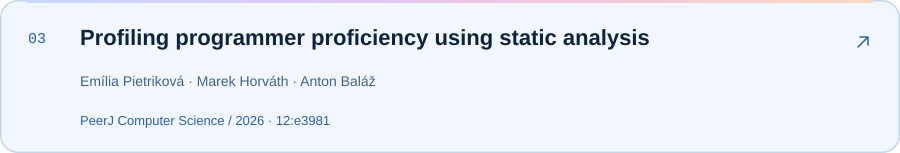
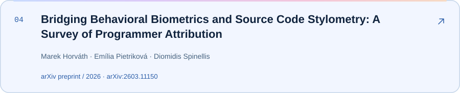
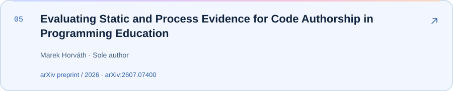

<picture>
  <source media="(prefers-reduced-motion: reduce) and (prefers-color-scheme: dark) and (max-width: 600px)" srcset="assets/hero-mobile-dark-still.svg">
  <source media="(prefers-reduced-motion: reduce) and (max-width: 600px)" srcset="assets/hero-mobile-light-still.svg">
  <source media="(prefers-reduced-motion: reduce) and (prefers-color-scheme: dark)" srcset="assets/hero-dark-still.svg">
  <source media="(prefers-reduced-motion: reduce)" srcset="assets/hero-light-still.svg">
  <source media="(prefers-color-scheme: dark) and (max-width: 600px)" srcset="assets/hero-mobile-dark.svg">
  <source media="(max-width: 600px)" srcset="assets/hero-mobile-light.svg">
  <source media="(prefers-color-scheme: dark)" srcset="assets/hero-dark.svg">
  
</picture>

  <a href="https://marek-horvath.github.io/portfolio/">
    <picture>
      <source media="(prefers-color-scheme: dark)" srcset="assets/link-portfolio-dark.svg">
      
    </picture>
  </a>
  <a href="https://scholar.google.com/citations?user=9q0s2u4AAAAJ&amp;hl=en">
    <picture>
      <source media="(prefers-color-scheme: dark)" srcset="assets/link-scholar-dark.svg">
      
    </picture>
  </a>
  <a href="https://www.linkedin.com/in/horvathmar/">
    <picture>
      <source media="(prefers-color-scheme: dark)" srcset="assets/link-linkedin-dark.svg">
      
    </picture>
  </a>
  <a href="mailto:marek.horvath@tuke.sk">
    <picture>
      <source media="(prefers-color-scheme: dark)" srcset="assets/link-email-dark.svg">
      
    </picture>
  </a>

My research focuses on **source code analysis, programmer authorship attribution, behavioral biometrics, and machine learning**. I teach programming and software engineering at the Technical University of Košice.

<h3><picture>
  <source media="(prefers-color-scheme: dark) and (max-width: 600px)" srcset="assets/research-journals-mobile-dark.svg">
  <source media="(max-width: 600px)" srcset="assets/research-journals-mobile-light.svg">
  <source media="(prefers-color-scheme: dark)" srcset="assets/research-journals-dark.svg">
  
</picture></h3>

<a href="https://doi.org/10.18267/j.aip.283"><picture>
  <source media="(prefers-color-scheme: dark) and (max-width: 600px)" srcset="assets/paper-learning-analytics-mobile-dark.svg">
  <source media="(max-width: 600px)" srcset="assets/paper-learning-analytics-mobile-light.svg">
  <source media="(prefers-color-scheme: dark)" srcset="assets/paper-learning-analytics-dark.svg">
  
</picture></a>

<a href="https://doi.org/10.12700/APH.23.5.2026.5.11"><picture>
  <source media="(prefers-color-scheme: dark) and (max-width: 600px)" srcset="assets/paper-llm-benchmark-mobile-dark.svg">
  <source media="(max-width: 600px)" srcset="assets/paper-llm-benchmark-mobile-light.svg">
  <source media="(prefers-color-scheme: dark)" srcset="assets/paper-llm-benchmark-dark.svg">
  
</picture></a>

<a href="https://doi.org/10.7717/peerj-cs.3981"><picture>
  <source media="(prefers-color-scheme: dark) and (max-width: 600px)" srcset="assets/paper-programmer-proficiency-mobile-dark.svg">
  <source media="(max-width: 600px)" srcset="assets/paper-programmer-proficiency-mobile-light.svg">
  <source media="(prefers-color-scheme: dark)" srcset="assets/paper-programmer-proficiency-dark.svg">
  
</picture></a>

<h3><picture>
  <source media="(prefers-color-scheme: dark) and (max-width: 600px)" srcset="assets/research-preprints-mobile-dark.svg">
  <source media="(max-width: 600px)" srcset="assets/research-preprints-mobile-light.svg">
  <source media="(prefers-color-scheme: dark)" srcset="assets/research-preprints-dark.svg">
  
</picture></h3>

<a href="https://arxiv.org/abs/2603.11150"><picture>
  <source media="(prefers-color-scheme: dark) and (max-width: 600px)" srcset="assets/paper-attribution-survey-mobile-dark.svg">
  <source media="(max-width: 600px)" srcset="assets/paper-attribution-survey-mobile-light.svg">
  <source media="(prefers-color-scheme: dark)" srcset="assets/paper-attribution-survey-dark.svg">
  
</picture></a>

<a href="https://arxiv.org/abs/2607.07400"><picture>
  <source media="(prefers-color-scheme: dark) and (max-width: 600px)" srcset="assets/paper-authorship-evidence-mobile-dark.svg">
  <source media="(max-width: 600px)" srcset="assets/paper-authorship-evidence-mobile-light.svg">
  <source media="(prefers-color-scheme: dark)" srcset="assets/paper-authorship-evidence-dark.svg">
  
</picture></a>

[All publications ↗](https://scholar.google.com/citations?user=9q0s2u4AAAAJ&hl=en) · [Survey code & bibliography ↗](https://github.com/marek-horvath/survey-extracting-script)

<h3><picture>
  <source media="(prefers-color-scheme: dark) and (max-width: 600px)" srcset="assets/toolkit-mobile-dark.svg">
  <source media="(max-width: 600px)" srcset="assets/toolkit-mobile-light.svg">
  <source media="(prefers-color-scheme: dark)" srcset="assets/toolkit-dark.svg">
  
</picture></h3>

Publication links & citations (text version)

#### Journal articles

**[Personalized Learning Analytics Through Static Code Analysis in Computer Science Education](https://doi.org/10.18267/j.aip.283)** Marek Horváth · Emília Pietriková · Filip Gurbáľ 2026 · *Acta Informatica Pragensia*, 15(1), 54–71

**[Benchmarking AI Models for Grading CS Assignments Across Multiple Domains](https://doi.org/10.12700/APH.23.5.2026.5.11)** Marek Horváth · Lukáš Tomaščík · Nikola Geciová · Norbert Ádám · Emília Pietriková 2026 · *Acta Polytechnica Hungarica*, 23(5), 207–226

**[Profiling programmer proficiency using static analysis](https://doi.org/10.7717/peerj-cs.3981)** Emília Pietriková · Marek Horváth · Anton Baláž 2026 · *PeerJ Computer Science*, 12:e3981

#### arXiv preprints

**[Bridging Behavioral Biometrics and Source Code Stylometry: A Survey of Programmer Attribution](https://arxiv.org/abs/2603.11150)** Marek Horváth · Emília Pietriková · Diomidis Spinellis 2026 · arXiv:2603.11150

**[Evaluating Static and Process Evidence for Code Authorship in Programming Education](https://arxiv.org/abs/2607.07400)** Marek Horváth — sole author 2026 · arXiv:2607.07400

