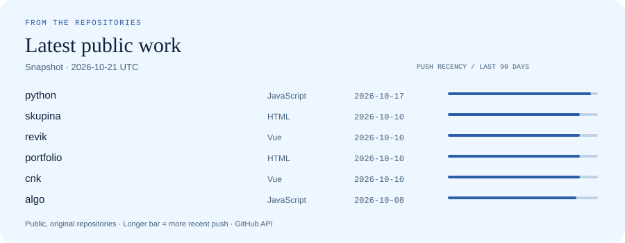

<picture>
  <source media="(prefers-color-scheme: dark) and (max-width: 600px)" srcset="assets/hero-mobile-dark.svg">
  <source media="(max-width: 600px)" srcset="assets/hero-mobile-light.svg">
  <source media="(prefers-color-scheme: dark)" srcset="assets/hero-dark.svg">
  
</picture>

[Portfolio](https://marek-horvath.github.io/portfolio/) · [Google Scholar](https://scholar.google.com/citations?user=9q0s2u4AAAAJ&hl=en) · [LinkedIn](https://www.linkedin.com/in/horvathmar/) · [Email](mailto:marek.horvath@tuke.sk)

I study what source code can tell us about its author: programming style, structural similarities, and the behavioral signals behind how software is written. My research connects **programmer authorship attribution, source code stylometry, behavioral biometrics, and machine learning**.

I’m an Assistant Professor at the **Technical University of Košice**, where I teach programming and software engineering. I completed my PhD in Informatics in August 2026. Alongside research, I build tools for teaching, web applications, and websites for communities and local businesses.

### Selected work

| Project | What it does |
| :--- | :--- |
| [Programmer attribution survey](https://github.com/marek-horvath/survey-extracting-script) | Curated bibliography and Python analysis script supporting a review of source code stylometry and behavioral biometrics. [Archived artifact ↗](https://zenodo.org/records/18641274) |
| [LLM assessment benchmark](https://github.com/marek-horvath/Benchmarking-LLM-assignements) | A grading pipeline for locally hosted models, with prompt templates and sample evaluation outputs for computer science assignments. |
| [Python course](https://github.com/marek-horvath/python) | Bilingual learning materials, lectures, and practical exercises for university teaching. [Course ↗](https://marek-horvath.github.io/python/) |
| [Karel online](https://github.com/marek-horvath/algo) | A browser environment for algorithm practice, with an editor, tasks, and Karel’s world. |
| [Cloud Native Košice](https://github.com/marek-horvath/cnk) | A Vue community website for meetups, event history, signup, and custom analytics. [Website ↗](https://marek-horvath.github.io/cnk/) |
| [Revik](https://github.com/marek-horvath/revik) | A Vue website for a local service business, focused on its offer, contact flow, and visitor actions. [Website ↗](https://www.revik.sk/) |

Also in practice: [Athena](https://athena.kpi.fei.tuke.sk), an assessment system that retrieves GitLab submissions, runs tests in isolated Docker containers, and collects structured results; and the [Software Engineering and Usability Group website](https://seug.kpi.fei.tuke.sk/), with automated publication updates. More projects are in my [portfolio](https://marek-horvath.github.io/portfolio/).

### Selected research

**[Bridging Behavioral Biometrics and Source Code Stylometry: A Survey of Programmer Attribution](https://arxiv.org/abs/2603.11150)** 
2026 · Preprint · With Emília Pietriková and Diomidis Spinellis 
A systematic mapping of programmer attribution methods, features, datasets, and evaluation practices. [Code and bibliography](https://github.com/marek-horvath/survey-extracting-script)

**[Detecting Programmer Identity from Source Code with Machine Learning Methods](https://doi.org/10.1109/ICETA67772.2025.11280212)** 
2025 · ICETA · With Martin Čupalka and Emília Pietriková

**[Adaptation of Automated Assessment System for Large Programming Courses](https://doi.org/10.4230/OASIcs.ICPEC.2024.4)** 
2024 · ICPEC · With Tomáš Kormaník and Jaroslav Porubän

[Full publication list →](https://scholar.google.com/citations?user=9q0s2u4AAAAJ&hl=en)

### Working toolkit

**Analysis & research** — Python · source code analysis · machine learning · BibTeX 
**Interfaces** — Vue · Angular · JavaScript · HTML/CSS · UI/UX 
**Delivery & teaching** — Git/GitLab · Docker · Selenium · C · Godot

### Public repository activity

<picture>
  <source media="(prefers-color-scheme: dark) and (max-width: 600px)" srcset="assets/activity-mobile-dark.svg">
  <source media="(max-width: 600px)" srcset="assets/activity-mobile-light.svg">
  <source media="(prefers-color-scheme: dark)" srcset="assets/activity-dark.svg">
  
</picture>

Latest pushes across public, original repositories; excludes this profile and archived repositories. A dated snapshot, refreshed daily with GitHub Actions. [Live repositories](https://github.com/marek-horvath?tab=repositories) · [How this profile works](PROFILE.md)
